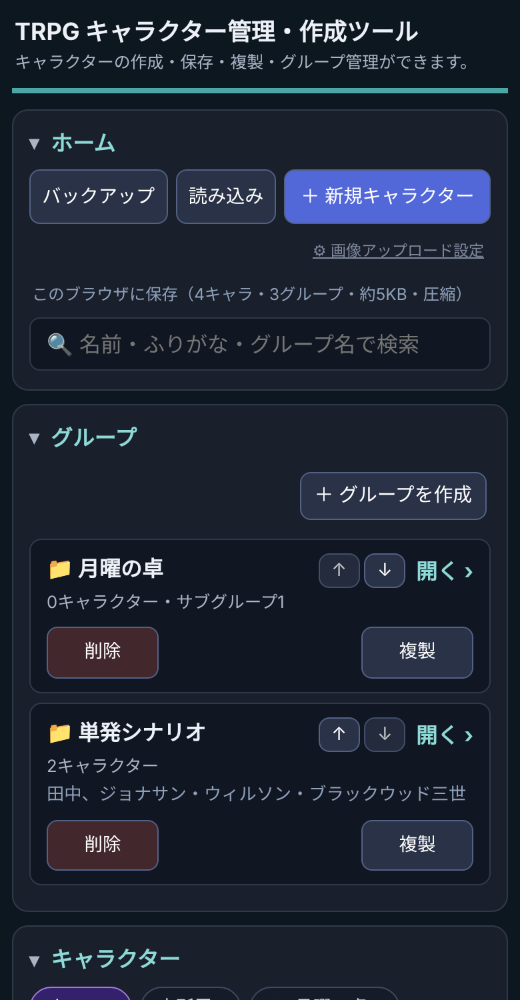

# TRPG キャラクター作成・管理ツール

クトゥルフ神話TRPG（6版）の探索者を、スマホのブラウザで作って・保存して・友達と共有するためのツールです。
HTML 1ファイルだけで動き、サーバーもインストールも要りません。

**▶ 使う: https://65256619ko-sudo.github.io/TRPG_Char_Maker/**

## できること

- 能力値・技能の入力と、派生ステータス（HP・MP・SAN・ダメージボーナスなど）の自動計算
- ココフォリア用のキャラクターデータ（JSON）とチャットパレットの書き出し・読み込み
  - 技能値は `{こぶし}` のように名前で参照するので、成長で値が変わってもパレットがそのまま使えます
  - `1dMP` のようにダイスの個数や面数にも名前を使えます
- 技能・ステータスの成長記録（SAN の増減もまとめて記録）
- キャラクターのグループ管理（サブグループ、複製、並べ替え）
- 連続生成（ランダム探索者をまとめて作成）
- 立ち絵の登録
- 共有リンクの発行（キャラクターを URL 1本で友達に渡せます）
- バックアップの書き出し・読み込み

## データの扱い

- キャラクターデータは **使っている端末のブラウザ内（localStorage）にだけ**保存されます。サーバーには送られません。
- ブラウザや端末を変える、サイトの URL が変わる（ファイル直開き ↔ GitHub Pages など）と、保存データは引き継がれません。**「バックアップ」で書き出して「読み込み」**で移してください。
- 共有リンクを作るときだけ、立ち絵がある場合に画像が [Cloudinary](https://cloudinary.com/) へアップロードされます（共有時のみ。JSON の書き出しでは送信しません）。リンクが長くなりすぎるのを防ぐための仕組みで、ホームの「画像アップロード設定」から自分のアカウントに切り替えられます。

## 自分で動かす・改造する

ビルドは不要です。`index.html` をブラウザで開くだけで動きます。
HTML・CSS・JavaScript がすべて `index.html` の中に入っています。

GitHub Pages で公開する場合は、リポジトリの Settings → Pages で `main` ブランチの `/ (root)` を指定してください。

## 注意

- 非公式のファンメイドツールです。「クトゥルフ神話TRPG」および関連作品の権利は、それぞれの権利者に帰属します。ルールブックの文章・表などは含んでいません。
- ココフォリアの仕様変更などにより、書き出したデータが読み込めなくなることがあります。

## ライセンス

[MIT License](LICENSE)
